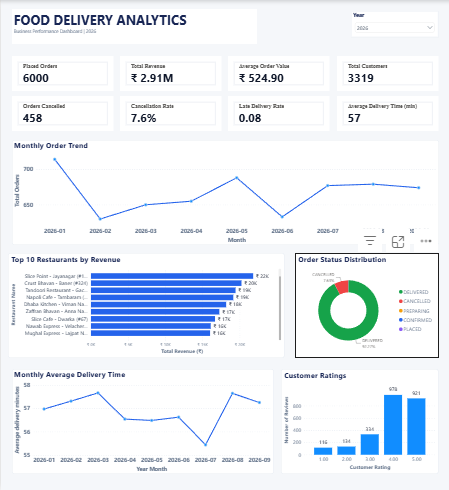

# Food Delivery Analytics — End-to-End Data Engineering Project

An end-to-end data engineering and business intelligence project that transforms food delivery operational data into analytical datasets and interactive Power BI reports.

The project demonstrates **MySQL, Fivetran, Snowflake SQL, dimensional modeling, data quality validation, and Power BI**.

## Dashboard Preview



**Power BI report:** [Open the Power BI report file](powerbi/Food_Delivery_Analytics_2026.pbix)

Download the report and open it using Microsoft Power BI Desktop.

## Project Overview

Food delivery businesses generate operational data about orders, restaurants, menu items, customers, delivery partners, and customer reviews. This project organizes that data into a reporting model to help analyze revenue, order trends, cancellations, customer satisfaction, and delivery efficiency.

### Architecture

**MySQL → AWS Aurora / Amazon RDS → Fivetran → Snowflake → Power BI**

1. **MySQL:** Stores the operational food delivery source data.
2. **AWS Aurora / Amazon RDS:** Represents the intended managed MySQL-compatible hosting layer. Current deployment status must be verified separately.
3. **Fivetran:** Replicates source data into Snowflake using binary-log-based change data capture (CDC).
4. **Snowflake:** Stores replicated data and supports staging, SQL transformations, data validation, and dimensional modeling.
5. **Power BI:** Presents business KPIs, trends, and operational insights through interactive reports.

See the [project architecture](architecture.md) for more details.

## Technology Stack

| Technology | Purpose |
|---|---|
| MySQL | Operational source database |
| AWS Aurora / Amazon RDS | Intended managed database hosting layer |
| Fivetran | Data ingestion and change data capture |
| Snowflake | Cloud data warehouse and SQL transformations |
| Power BI | Interactive business intelligence and reporting |
| Git and GitHub | Version control and project documentation |

## Dataset and Data Model

The source database is `food_ops`, with three principal source tables:

- `food_orders` — food order and order-line information.
- `restaurant_menu` — restaurant and menu item attributes.
- `customer_reviews` — customer ratings and review information.

The analytical model contains **six dimension tables and three fact tables**.

### Dimension tables

| Table | Purpose |
|---|---|
| `DIM_CUSTOMER` | Customer attributes |
| `DIM_RESTAURANT` | Restaurant and cuisine attributes |
| `DIM_ITEM` | Menu item and category attributes |
| `DIM_DELIVERY_PARTNER` | Delivery partner attributes |
| `DIM_LOCATION` | Location attributes |
| `DIM_DATE` | Calendar-based analysis |

### Fact tables

| Table | Grain |
|---|---|
| `FACT_ORDER_LINES` | One row per order line |
| `FACT_ORDERS` | One row per order |
| `FACT_REVIEWS` | One row per customer review |

Defining the grain of each fact table helps prevent double-counting when calculating revenue, orders, and other measures.

Read the [star schema documentation](star_schema.md) for more details.

## Key Project Metrics

The following figures were verified against the project report during development. Revenue and other measures depend on their business definitions and report filters.

| Metric | Verified value |
|---|---:|
| Total orders | 6,000 |
| Total order lines | 14,763 |
| Menu items | 5,180 |
| Customer reviews | 2,483 |
| Delivered revenue | ₹2,905,823 |
| Cancelled orders | 458 |
| Average delivery time | 56.88 minutes (approximately 57 minutes) |

**Revenue definition:** Delivered revenue excludes cancelled and in-progress orders in the verified report.

## Business Questions Addressed

The Power BI report supports analysis of:

- How does delivered revenue change over time?
- How many orders are placed each month?
- What proportion of orders are cancelled?
- Which restaurants perform best by order volume?
- How do customer ratings vary?
- What is the average delivery time by month?
- How can order status and operational performance be monitored?

See the [Power BI dashboard documentation](powerbi_dashboard.md).

## Repository Structure

```text
food-delivery-analytics/
├── README.md
├── architecture.md
├── star_schema.md
├── aws_aurora_setup.md
├── fivetran_setup.md
├── powerbi_dashboard.md
├── documentation/
│   └── architecture.md
├── mysql/
│   ├── README.md
│   ├── 01_ddl.sql
│   ├── 02_insert_food_orders.sql
│   ├── 03_insert_customer_reviews.sql
│   └── 04_insert_restaurant_menu.sql
├── snowflake/
│   ├── README.md
│   ├── 01_data_validation.sql
│   ├── 02_staging_views.sql
│   ├── 03_core_dimensions.sql
│   └── 04_core_fact_tables.sql
├── powerbi/
│   ├── README.md
│   └── Food_Delivery_Analytics_2026.pbix
└── screenshots/
    ├── .gitkeep
    └── food_delivery_overview.png
```

## Project Files

### MySQL source database

- [MySQL README and instructions](mysql/README.md)
- [01 — Create source tables](mysql/01_ddl.sql)
- [02 — Insert food orders](mysql/02_insert_food_orders.sql)
- [03 — Insert customer reviews](mysql/03_insert_customer_reviews.sql)
- [04 — Insert restaurant menu data](mysql/04_insert_restaurant_menu.sql)

### Snowflake data warehouse

- [Snowflake README and execution notes](snowflake/README.md)
- [01 — Data validation](snowflake/01_data_validation.sql.txt)
- [02 — Staging views](snowflake/02_staging_views.sql.txt)
- [03 — Core dimensions](snowflake/03_core_dimensions.sql.txt)
- [04 — Core fact tables](snowflake/04_core_fact_tables.sql.txt)

The Snowflake scripts currently use `.sql.txt` extensions. Review and rename them to `.sql` before presenting them as directly executable SQL files.

### Ingestion and architecture documentation

- [End-to-end architecture](architecture.md)
- [Architecture notes in the documentation folder](documentation/architecture.md)
- [Star schema and fact-table grain](star_schema.md)
- [AWS Aurora / RDS setup notes](aws_aurora_setup.md)
- [Fivetran ingestion and CDC notes](fivetran_setup.md)

### Power BI reporting

- [Power BI report documentation](powerbi_dashboard.md)
- [Power BI folder README](powerbi/README.md)
- [Download or view the PBIX file](powerbi/Food_Delivery_Analytics_2026.pbix)
- [Dashboard screenshot](screenshots/food_delivery_overview.png)

## Data Quality and Engineering Concepts

The project covers or documents the following engineering practices:

- Source-to-warehouse data validation.
- Null and duplicate identifier checks.
- Fivetran CDC metadata and deleted-record handling.
- Staging views and SQL transformations.
- Fact and dimension table design.
- Fact-table grain and double-counting prevention.
- Date-based analytical reporting.
- KPI validation against the Power BI report.

The SQL files should be checked against the verified Snowflake implementation before execution.

## Project Documentation

- [Project Summary](PROJECT_SUMMARY.md) — architecture, data warehouse design, verified metrics, and key learning outcomes.
- [Snowflake SQL Scripts](snowflake/) — data validation, staging views, dimensions, and fact tables.
- [Power BI Report](powerbi/Food_Delivery_Analytics_2026.pbix) — interactive food delivery analytics dashboard.
- [Dashboard Screenshot](screenshots/food_delivery_overview.png) — preview of the report.

## How to Explore the Project

1. Review this README and the architecture documentation.
2. Inspect the MySQL DDL and source data scripts.
3. Read the Fivetran setup notes to understand ingestion and CDC.
4. Review the Snowflake validation, staging, dimension, and fact scripts.
5. Read the star schema documentation.
6. Open the Power BI report in Power BI Desktop and explore the dashboard.

**Important:** Required database connections, permissions, and source data must be configured separately. The documented architecture does not by itself prove that a cloud resource is currently running.

## Security Notes

- Never commit database passwords, private keys, access tokens, or sensitive connection strings.
- Use secure credential storage and least-privilege access.
- Test database scripts in a development environment before executing them against an existing database.
- Do not publish sensitive customer information.

## Author

**Data Engineering and Business Intelligence Portfolio Project**

This project demonstrates practical learning across data ingestion, warehouse modeling, SQL transformations, data validation, and business reporting.
